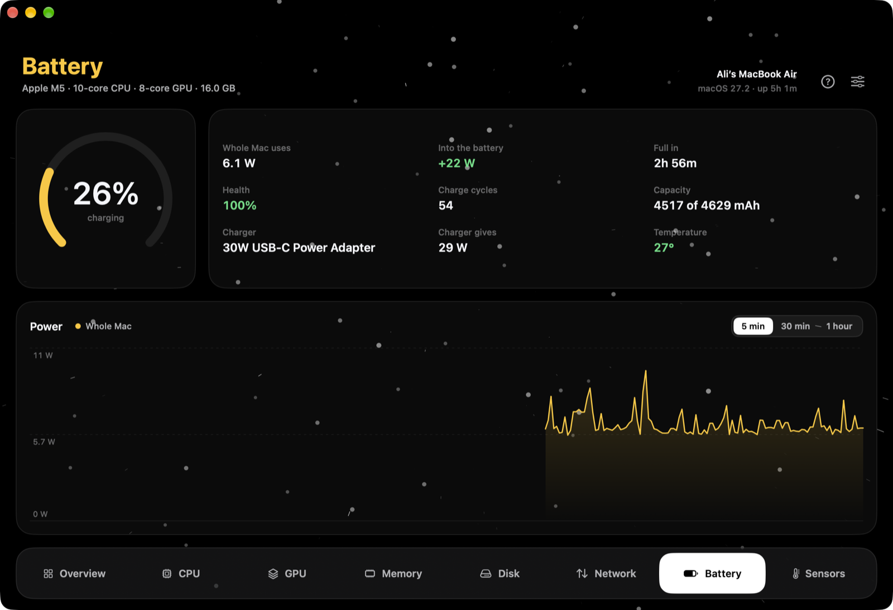
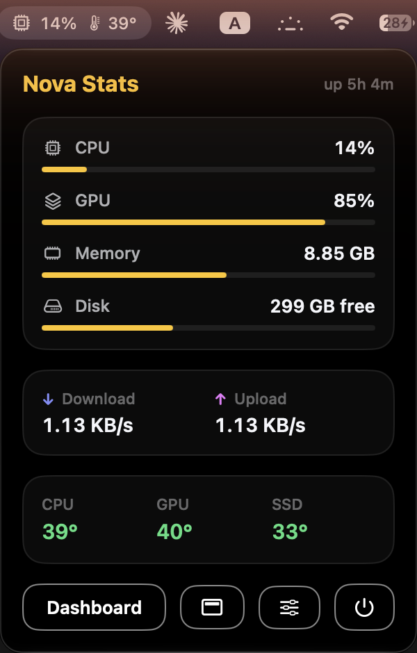
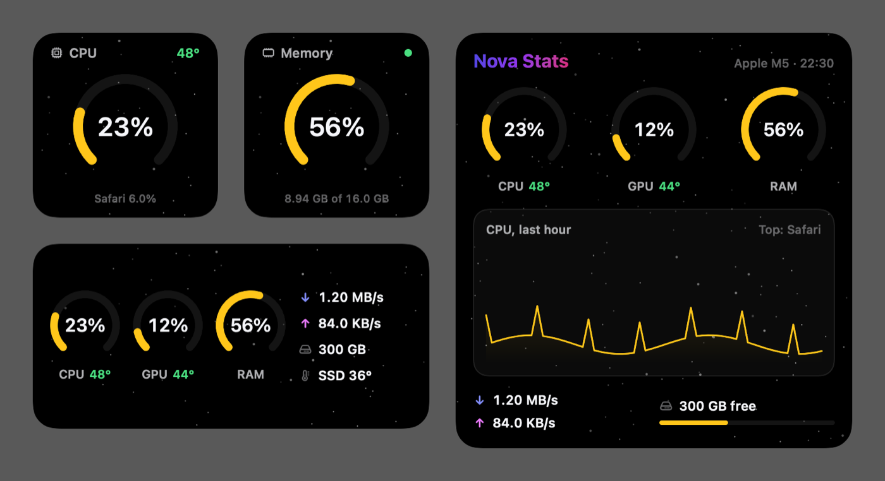
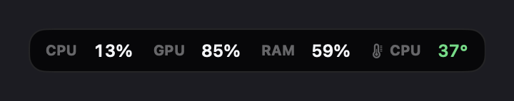
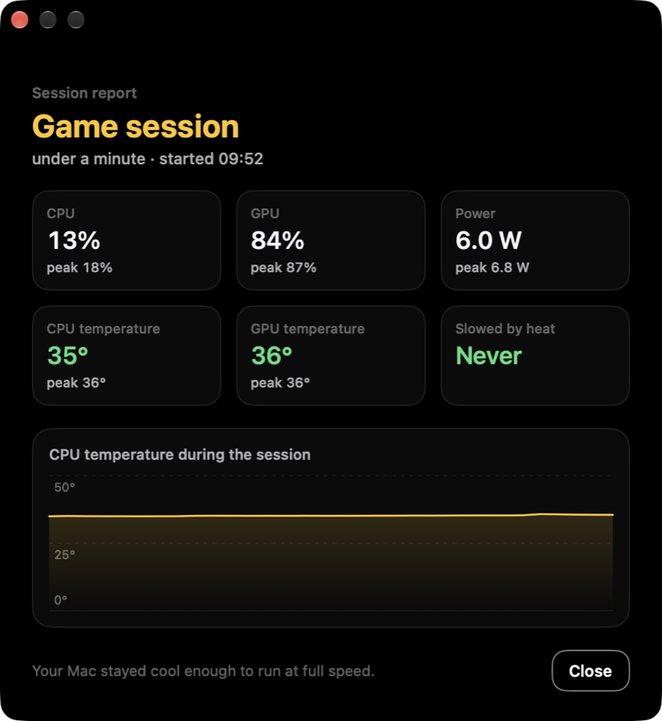
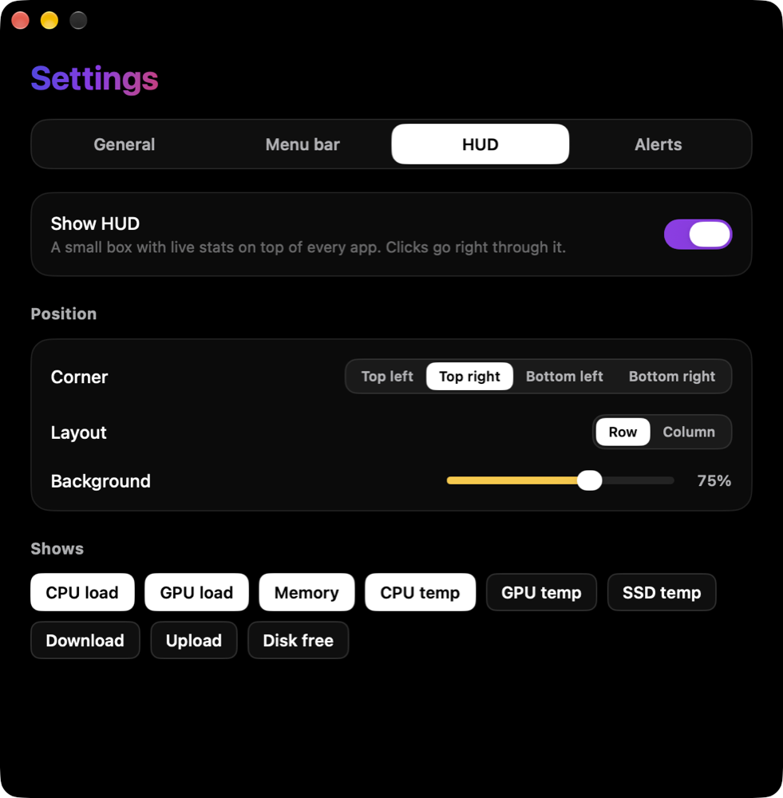
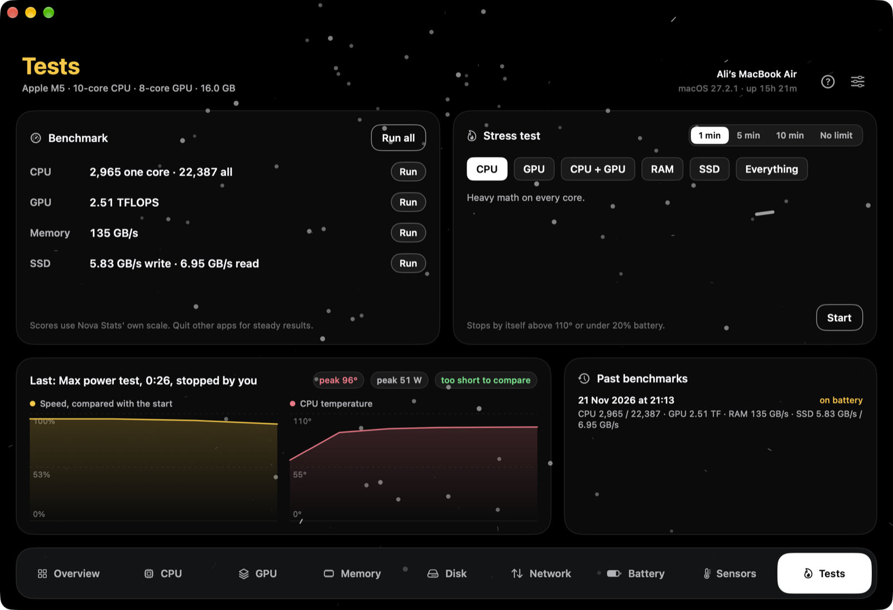

<div align="center">


# Nova Stats

**What your Mac is doing, in Nova's colors.**

CPU, GPU, memory, disk, network, battery and temperatures, in a dashboard,
the menu bar, desktop widgets and a game mode overlay.


**[Download for Mac](https://github.com/Mammad-Ali/nova-stats/releases/latest/download/Nova-Stats.dmg)** ·
**[Website](https://mammad-ali.github.io/nova-stats/)**

<br>


</div>

---

Nova Stats is the little brother of [Nova](https://github.com/Mammad-Ali/nova), my
network app. I wanted to see what my MacBook Air is doing without opening Activity
Monitor, and I wanted it to look like Nova: black, white stars and one yellow accent.
It's a native SwiftUI app, made for Apple Silicon.

## What it shows

- **CPU** load overall and per core, with efficiency and performance cores apart
- **GPU** load and the memory it's using
- **Memory** counted the way Activity Monitor counts it: app, wired, compressed,
  cached, swap and memory pressure, plus the apps using the most memory or CPU
  (all of Chrome's helpers count as one Chrome)
- **Disk** space and read/write speed, every connected drive, and an Eject button for
  external ones
- **Network** download and upload speed, Wi-Fi or Ethernet, local IP
- **Battery** charge, health, charge cycles, time left, the charger, and how many
  watts the whole Mac uses right now
- **Temperatures** for the CPU, GPU, SSD and battery, plus every other sensor the chip
  has, in °C or °F
- **History** for the last 5 minutes, 30 minutes or hour



## Where it shows it

| Menu bar | Widgets |
|:---:|:---:|
|  |  |

The menu bar shows the numbers you pick, with an optional tiny CPU graph. Its panel
has buttons for the dashboard, game mode and settings.

**Game mode** puts an overlay on top of your game, even in full screen: outlined text
with no box behind it, and clicks go right through it. You pick the corner, row or
column, and what it shows. It warns you when the Mac gets so hot that macOS slows it
down, and when you stop you get a report: how long you played and the average and peak
CPU, GPU, temperatures and power. Turn it on from the menu bar, with a shortcut, or let
it start by itself when a game goes full screen.

<p align="center">
  
  &nbsp;&nbsp;
  
</p>

**Shortcuts** work from any app: <kbd>⌃⌥N</kbd> opens or closes the dashboard,
<kbd>⌃⌥G</kbd> starts or stops game mode and <kbd>⌃⌥H</kbd> shows or hides its overlay.
You can change all three in Settings.

**Alerts** tell you when the Mac runs hot, memory gets tight, the disk is almost full
or the CPU has been busy for a minute. Each one at most every half hour.

Everything is optional and set up in **Settings**, a panel inside the dashboard
(<kbd>⌘,</kbd>), which also has an About page with the common questions:

<p align="center">
  
</p>

## Benchmark and stress test

The **Tests** tab benchmarks the CPU (one core and all cores), the GPU, memory and the
SSD, and keeps your past runs, marked on battery or plugged in, so you can compare them.
The scores are on Nova Stats' own scale, so they're for comparing your own runs, not
Geekbench numbers.

Its **stress tests** push the CPU, the GPU, both, the RAM, the SSD, or everything at once
(the max power test) for 1, 5 or 10 minutes or until you stop. Live charts show the speed
against the start and the temperature, so you can watch a fanless Mac slow down as it
heats up. The CPU, GPU, Memory, Disk and Battery tabs have their own buttons for the
same tests, so you can watch the cores fill up right where they're shown.

Tests stop by themselves above 110°, under 20% battery or when the time is up. The SSD
test only reads, so it doesn't wear the SSD, and the RAM test never takes so much memory
that macOS has to swap.



## Download

Get **[Nova-Stats.dmg](https://github.com/Mammad-Ali/nova-stats/releases/latest/download/Nova-Stats.dmg)**,
open it and drag Nova Stats into Applications. You need macOS 15 or newer.

The app isn't signed with a paid Apple developer account, so the first time macOS
says it can't check it. Open **System Settings → Privacy & Security**, scroll down and
press **Open Anyway**. You only do this once.

To get the widgets, right-click the desktop, choose **Edit Widgets** and look for Nova Stats.

## Build it yourself

You need Xcode.

```bash
git clone https://github.com/Mammad-Ali/nova-stats.git
cd nova-stats
./tool/install.sh
```

The script builds a release copy, checks the widget extension is sandboxed (macOS
won't load widgets otherwise) and puts the app in `/Applications`.
`./tool/release.sh 1.0.0` makes the DMG and publishes it as a GitHub release.

## Questions

The common ones (is it free, why macOS warns about it, does it send data anywhere,
how much it slows the Mac) are answered on the [website](https://mammad-ali.github.io/nova-stats/#questions)
and in the app under Settings → About.

## How it works

- **CPU**: `host_processor_info` tick counters, compared every second
- **Memory**: `host_statistics64`, with the same formula Activity Monitor uses
- **GPU**: `PerformanceStatistics` of the `IOAccelerator` in the IOKit registry
- **Disk**: `IOBlockStorageDriver` statistics for speed, the volumes' capacity for space
- **Network**: 64-bit interface counters from `sysctl` (`NET_RT_IFLIST2`), so they
  don't wrap around at 4 GB
- **Temperatures**: SMC keys through a small C helper (`Tp`/`Te` for CPU cores, `Tg`
  for the GPU on Apple Silicon) and the IOHID temperature sensors for the SSD and battery
- **Battery and power**: the `AppleSmartBattery` registry entry, and the SMC's `PSTR`
  (whole system) and `PDTR` (charger) power keys
- **Apps**: `proc_pid_rusage` for every process, grouped by the `.app` they belong to
- **Shortcuts**: Carbon hot keys, which need no accessibility permission
- **Background work**: anything you can't see right now (a closed dashboard, a tab
  you're not on) is measured every 5 to 30 seconds instead of every second, so with
  only the menu bar it costs about 1–2% of one CPU core
- **Benchmarks and stress tests**: integer and vector math on every core, a Metal
  shader made of independent multiply-adds for the GPU, a parallel copy of big buffers
  for memory, and reads and writes past the system cache (`F_NOCACHE`) for the SSD
- **Stars**: drawn with Metal, so the open dashboard costs about 7% of one CPU core. The shader compiles at launch, so the project builds
  without Xcode's separate Metal toolchain
- **Widgets**: the app writes a small JSON file to `~/Library/Application Support/Nova Stats`
  and the sandboxed widget reads it through a read-only exception. An app group would
  be the usual way, but that needs a paid developer account

The app isn't sandboxed itself, because the SMC can't be read from inside the sandbox.
It never connects to the internet.

## Layout

```
NovaStats/         the app: sensors, model, windows and views
NovaStatsWidgets/  the widget extension
Shared/            theme, formatting, charts and widget data, used by both
Config/            Info.plists and the widget's entitlements
docs/              the website (GitHub Pages) and the pictures in this README
tool/              install and release scripts, and the app icon generator
```

## License

[MIT](LICENSE)
