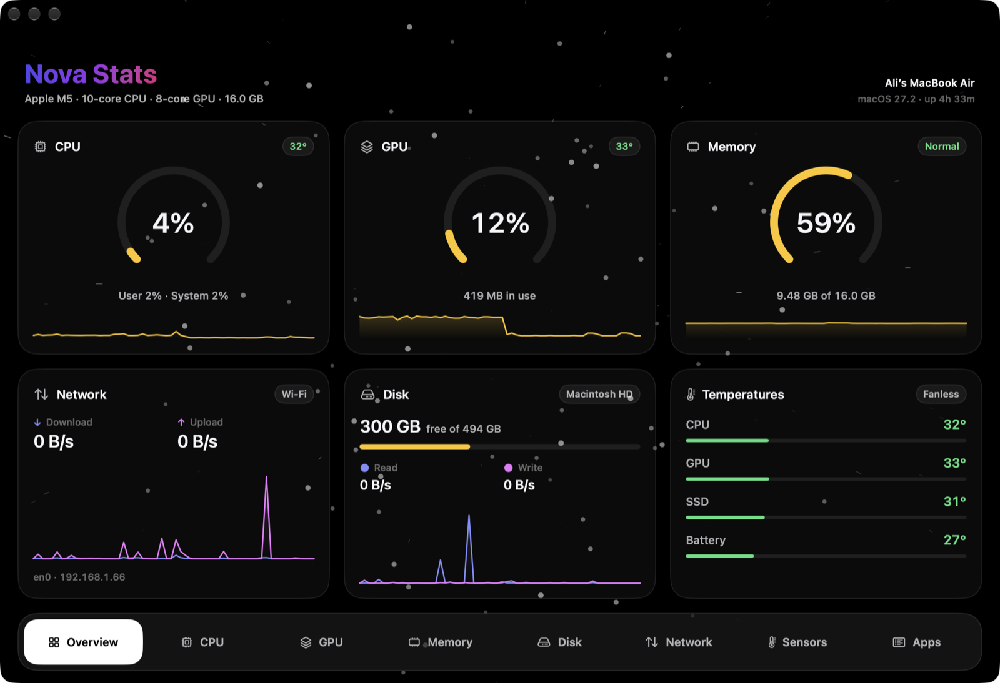

<div align="center">


# Nova Stats

**What your Mac is doing, in Nova's colours.**

CPU, GPU, memory, disk, network and temperatures, in a dashboard,
the menu bar, a small HUD over your other apps and desktop widgets.


<br>



</div>

---

Nova Stats is the little brother of [Nova](https://github.com/Mammad-Ali/nova), my
network app. I wanted to see what my MacBook Air is doing without opening Activity
Monitor, and I wanted it to look like Nova: black, white stars and one yellow accent.
It's a native SwiftUI app, made for Apple Silicon.

## What it shows

- **CPU** load overall and per core, with efficiency and performance cores apart
- **GPU** load and the memory it's using
- **Memory** counted the way Activity Monitor counts it: app, wired, compressed,
  cached, swap and memory pressure
- **Disk** space left and how fast it's reading and writing
- **Network** download and upload speed, Wi-Fi or Ethernet, local IP
- **Temperatures** for the CPU, GPU, SSD and battery, plus every other sensor the chip has
- **Apps** using the most CPU and memory, with helper processes counted under their app
  (all of Chrome's helpers show up as one Chrome)
- **History** for the last 5 minutes, 30 minutes or hour

## Where it shows it

| Menu bar | Widgets |
|:---:|:---:|
|  |  |

The **HUD** is a small box that stays on top of every app, even full screen ones,
and lets clicks go right through it. You pick the corner, the layout and what it shows.

<p align="center">
  
</p>

**Alerts** tell you when the Mac runs hot, memory gets tight, the disk is almost full
or the CPU has been busy for a minute. Each one at most every half hour.

Everything is optional and set up in **Settings**:

<p align="center">
  
</p>

## Install

You need macOS 15 or newer, and Xcode to build it.

```bash
git clone https://github.com/Mammad-Ali/nova-stats.git
cd nova-stats
./tool/install.sh
```

The script builds a release copy, checks the widget extension is sandboxed (macOS
won't load widgets otherwise) and puts the app in `/Applications`. To get the
widgets, right-click the desktop, choose **Edit Widgets** and look for Nova Stats.

## How it works

- **CPU**: `host_processor_info` tick counters, compared every second
- **Memory**: `host_statistics64`, with the same formula Activity Monitor uses
- **GPU**: `PerformanceStatistics` of the `IOAccelerator` in the IOKit registry
- **Disk**: `IOBlockStorageDriver` statistics for speed, the volume's capacity for space
- **Network**: 64-bit interface counters from `sysctl` (`NET_RT_IFLIST2`), so they
  don't wrap around at 4 GB
- **Temperatures**: SMC keys through a small C helper (`Tp`/`Te` for CPU cores, `Tg`
  for the GPU on Apple Silicon) and the IOHID temperature sensors for the SSD and battery
- **Apps**: `proc_pid_rusage` for every process, grouped by the `.app` they belong to
- **Stars**: drawn with Metal, so the open dashboard costs about 7% of one CPU core and
  a closed one about 1%. The shader compiles at launch, so the project builds
  without Xcode's separate Metal toolchain
- **Widgets**: the app writes a small JSON file to `~/Library/Application Support/Nova Stats`
  and the sandboxed widget reads it through a read-only exception. An app group would
  be the usual way, but that needs a paid developer account

The app isn't sandboxed itself, because the SMC can't be read from inside the sandbox.

## Layout

```
NovaStats/         the app: sensors, model, windows and views
NovaStatsWidgets/  the widget extension
Shared/            theme, formatting, charts and widget data, used by both
Config/            Info.plists and the widget's entitlements
tool/              install script and the app icon generator
```

## License

[MIT](LICENSE)
